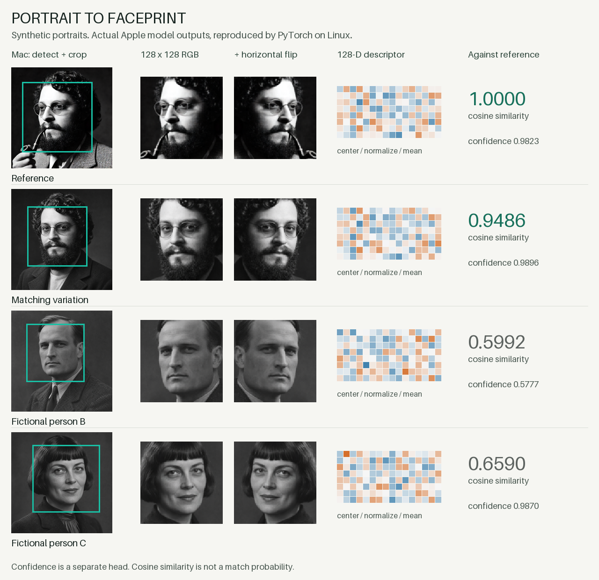

# apple-faceprint

Run the face-recognition model already on your Mac in PyTorch on Linux. Frozen weights; gradients to pixels.

```sh
uv run export_model.py                         # on macOS
# Copy this checkout and the exported model/ directory to Linux.
uv sync
uv run example.py examples/crops/reference.png
```



[Demo and scores](docs/demo.md) · [Findings](docs/findings.md)

Currently tested: `facerec_fp4.0_fa1.4_md2_2_fp16`. Input: 128×128 RGB face crops. `VisionFaceprint` reproduces Vision's descriptor and confidence; `Faceprint` exposes the raw network heads.

Code and public demo images only. Export your own system weights. Face detection isn't included; the optional crop sampler approximates Apple's resampling. [MIT](LICENSE).

## Photos.sqlite (training-crop source list)

To build a candidate list of stills for one named person, query a **copy** of the local Photos database. Copy it out of the library first (Photos may have the file open), then query that copy read-only. Never commit `Photos.sqlite`, its WAL/SHM sidecars, or anything from a `.photoslibrary`.

```text
~/Pictures/Photos Library.photoslibrary/database/Photos.sqlite
```

```sh
cp "$HOME/Pictures/Photos Library.photoslibrary/database/Photos.sqlite" /tmp/Photos.sqlite
python tools/list_person_faces.py --db /tmp/Photos.sqlite --person <ZPERSON.Z_PK> -o faces.csv
```

`tools/list_person_faces.py` opens the copy with `mode=ro` and lists faces for that person using the full-body mining filters: still photo, not a screenshot or screen recording, not hidden or trashed, face size ≤ 0.2, at most 4 faces in the frame. Originals live under `<library>/originals/`. Face detection and the 128×128 network crops still go through Vision (`tools/native_capture.m`); this pass only names which assets to open.
