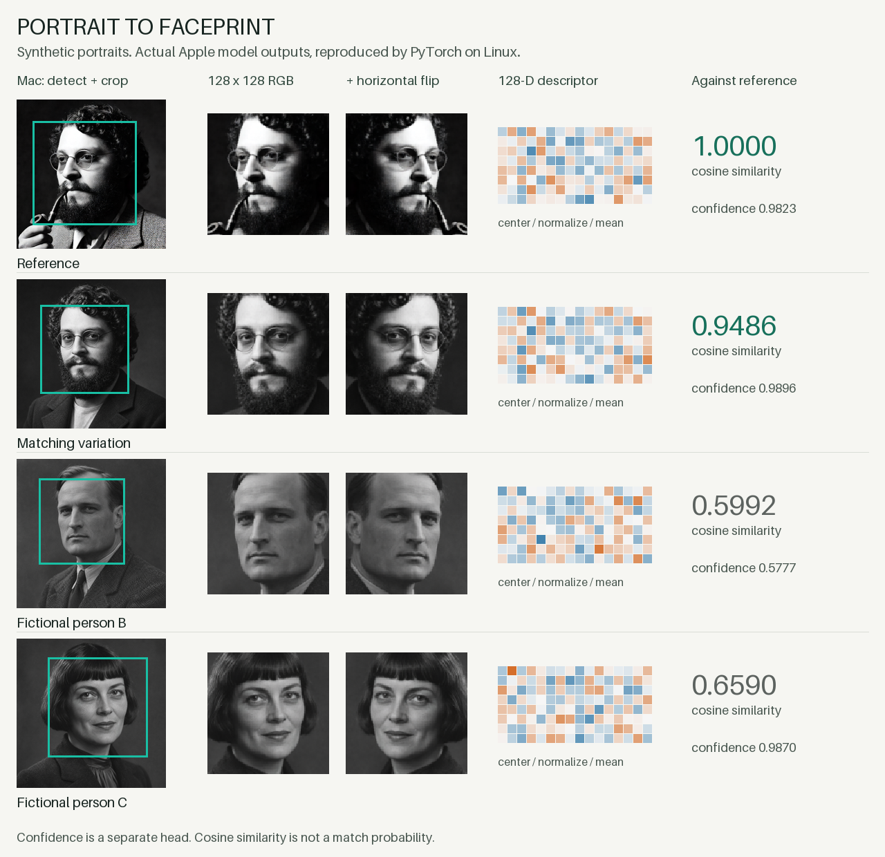

# From portrait to faceprint

1. Native Vision detects the face and creates the RGB crop shown here.
2. PyTorch runs the crop and its horizontal mirror through the exported network.
3. Each embedding is mean-centered and normalized; the two are averaged. Confidence is averaged separately.
4. Normalize the final descriptors and take their dot product to compare faces.

| Portrait | Cosine vs reference | Confidence |
|---|---:|---:|
| Reference | 1.0000 | 0.9823 |
| Matching variation | 0.9486 | 0.9896 |
| Fictional person B | 0.5992 | 0.5777 |
| Fictional person C | 0.6590 | 0.9870 |

The matching variation was generated from the supplied reference; B and C are new fictional people. These are examples, not a recognition benchmark. Confidence is not identity similarity, and cosine is not a probability.

On these four inputs, the Linux port's maximum error against native CPU Vision was **1.8e-07** for the descriptor and **3e-07** for confidence.

[Reproduce it](findings.md#reproduce-the-illustrated-demo) · [Image provenance and prompts](prompts.md)
